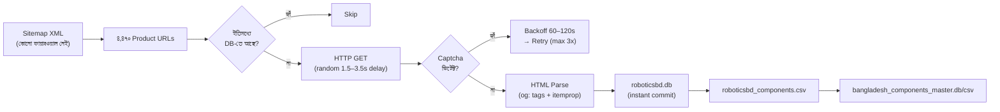

# 🤖 RoboticsBD Scraping — AI Agent Playbook

> [!IMPORTANT]
> এই playbook যেকোনো AI agent-কে দিলে সে ভুল না করে RoboticsBD-এর সম্পূর্ণ ৪,৪৭০টি প্রোডাক্ট স্ক্র্যাপ করতে পারবে। প্রতিটি ধাপ self-contained এবং idempotent — যেকোনো সময় থামিয়ে আবার চালু করলেও ডেটা হারাবে না।

---

## 📊 বর্তমান অবস্থা

| মেট্রিক | মান |
|---|---|
| মোট প্রোডাক্ট (Sitemap) | **৪,৪৭০** |
| ইতিমধ্যে স্ক্র্যাপড | **২৯৭** |
| বাকি আছে | **~৪,১৮০** |
| Master DB-তে RoboticsBD | মাত্র ১৭টি |
| আনুমানিক সময় | **১.৫ — ২.৫ ঘণ্টা** |

---

## 🏗️ আর্কিটেকচার সারাংশ



---

## ⚙️ AI Agent-কে দেওয়ার জন্য Step-by-Step নির্দেশনা

### AI Agent-কে হুবহু যা বলবেন:

---

### ধাপ ১: স্ক্রিপ্ট ভেরিফাই

```
"C:\Users\HP\OneDrive\Desktop\alukochu\roboticsbd_scraper.py" ফাইলটি পড়ো এবং
নিশ্চিত করো যে এতে নিচের ফিচারগুলো আছে:

1. Sitemap থেকে URL ফেচ (https://store.roboticsbd.com/1_en_0_sitemap.xml)
2. ডাটাবেসে আগে থেকে থাকা URL skip করা (resumable)
3. প্রতিটি প্রোডাক্ট ফেচের পর 1.5–3.5 সেকেন্ড random delay
4. Captcha/block ডিটেকশন ও 60–120 সেকেন্ড adaptive backoff
5. প্রতিটি প্রোডাক্ট save-এর পর তাৎক্ষণিক DB commit
6. শেষে CSV export ও master DB merge

সব ঠিক থাকলে পরের ধাপে যাও।
```

---

### ধাপ ২: স্ক্রিপ্ট চালানো

```
নিচের কমান্ডটি background task হিসেবে চালাও:

python "C:\Users\HP\OneDrive\Desktop\alukochu\roboticsbd_scraper.py"

এটি একটি long-running task — IsDaemon=true দিয়ে চালাও।
এটি শেষ হতে ১.৫ থেকে ২.৫ ঘণ্টা সময় লাগতে পারে।
```

---

### ধাপ ৩: প্রোগ্রেস মনিটরিং

```
প্রতি ১৫ মিনিটে একবার নিচের Python কোড চালিয়ে প্রোগ্রেস রিপোর্ট দাও:

import sqlite3
conn = sqlite3.connect(r"C:\Users\HP\OneDrive\Desktop\alukochu\roboticsbd.db")
c = conn.cursor()
total = c.execute("SELECT COUNT(*) FROM components").fetchone()[0]
latest = c.execute("SELECT scraped_at FROM components ORDER BY scraped_at DESC LIMIT 1").fetchone()
print(f"Scraped so far: {total}/4470")
print(f"Latest: {latest}")
conn.close()
```

---

### ধাপ ৪: শেষ হওয়ার পর ভেরিফিকেশন

```
স্ক্র্যাপিং শেষ হলে নিচের চেকগুলো চালাও:

1. roboticsbd.db-তে কতগুলো row আছে?
2. roboticsbd_components.csv ফাইল তৈরি হয়েছে এবং row count ঠিক আছে?
3. bangladesh_components_master.db-তে RoboticsBD source_store-এ কতগুলো row?
4. bangladesh_components_master.csv আপডেট হয়েছে?
5. roboticsbd_scraper.log ফাইলে কোনো ERROR আছে কিনা?

সব ঠিক থাকলে আমাকে ফাইনাল রিপোর্ট দাও।
```

---

## 🛡️ যদি কিছু ভুল হয় — Troubleshooting Guide

### সমস্যা ১: "CAPTCHA/block detected" লগে বারবার আসছে

**সমাধান:** স্ক্রিপ্টে `MIN_DELAY` এবং `MAX_DELAY` বাড়িয়ে দাও:
```python
MIN_DELAY = 3.0   # আগে 1.5 ছিল
MAX_DELAY = 6.0   # আগে 3.5 ছিল
```

---

### সমস্যা ২: "no product name found" অনেকগুলো URL-এ আসছে

**কারণ:** সম্ভবত URL redirect হচ্ছে অথবা পেজ স্ট্রাকচার পরিবর্তন হয়েছে।

**সমাধান:**
```
ব্রাউজারে ঐ URL গুলো ম্যানুয়ালি খুলে দেখো পেজ লোড হচ্ছে কিনা।
যদি redirect হয়, তাহলে parser-এ fallback pattern যোগ করো।
```

---

### সমস্যা ৩: স্ক্রিপ্ট মাঝপথে ক্র্যাশ করেছে

**সমাধান:** কিছু করার দরকার নেই! আবার রান করো:
```
python "C:\Users\HP\OneDrive\Desktop\alukochu\roboticsbd_scraper.py"
```
স্ক্রিপ্ট আগে থেকে DB-তে থাকা URL গুলো skip করে বাকিগুলো থেকে শুরু করবে।

---

### সমস্যা ৪: Stock quantity সব জায়গায় 0 আসছে

**কারণ:** PrestaShop stock data JavaScript-এ dynamically লোড হতে পারে।

**সমাধান:** `data-stock` attribute না পেলে page-এ `data-quantity` বা `availableQuantity` খোঁজো এবং parser আপডেট করো।

---

## 📁 ফাইল ম্যাপ

| ফাইল | উদ্দেশ্য |
|---|---|
| [roboticsbd_scraper.py](file:///C:/Users/HP/OneDrive/Desktop/alukochu/roboticsbd_scraper.py) | মূল স্ক্র্যাপার স্ক্রিপ্ট |
| [roboticsbd.db](file:///C:/Users/HP/OneDrive/Desktop/alukochu/roboticsbd.db) | RoboticsBD প্রোডাক্ট ডাটাবেস |
| [roboticsbd_components.csv](file:///C:/Users/HP/OneDrive/Desktop/alukochu/roboticsbd_components.csv) | CSV এক্সপোর্ট |
| [bangladesh_components_master.db](file:///C:/Users/HP/OneDrive/Desktop/alukochu/bangladesh_components_master.db) | সকল স্টোরের মাস্টার ডাটাবেস |
| `roboticsbd_scraper.log` | স্ক্র্যাপিং লগ (ডিবাগিং-এর জন্য) |

---

## 🔑 কেন এই পদ্ধতি কাজ করে

1. **Sitemap-এ কোনো ফায়ারওয়াল নেই** — সব URL একবারে বিনামূল্যে পাওয়া যায়, কোনো pagination crawling-এর ঝামেলা নেই
2. **Single-threaded + random delay** — সার্ভার মনে করে একজন সাধারণ মানুষ ব্রাউজ করছে
3. **`og:title`, `itemprop="price"` ব্যবহার** — এগুলো SEO-এর জন্য সাইট নিজেই দেয়, পরিবর্তন হওয়ার সম্ভাবনা কম
4. **Instant commit + resumable** — বিদ্যুৎ চলে গেলেও, ইন্টারনেট কেটে গেলেও ডেটা সুরক্ষিত

> [!TIP]
> রাত ১২টা–১টার দিকে স্ক্রিপ্ট চালু করে ঘুমাতে যান। সকালে উঠে দেখবেন ৪,৪৭০টি প্রোডাক্ট সহ মাস্টার ডাটাসেট ~১৬,৫০০+ কম্পোনেন্টে উন্নীত হয়ে গেছে।
